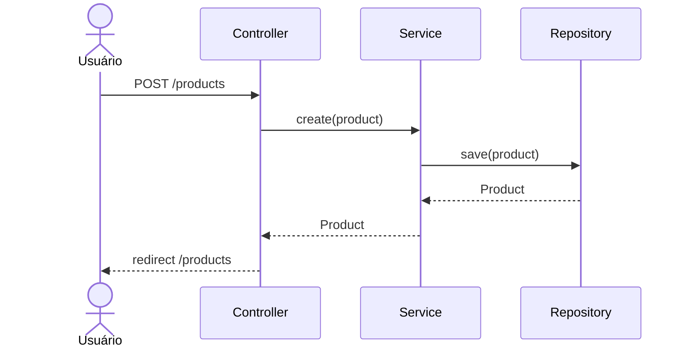
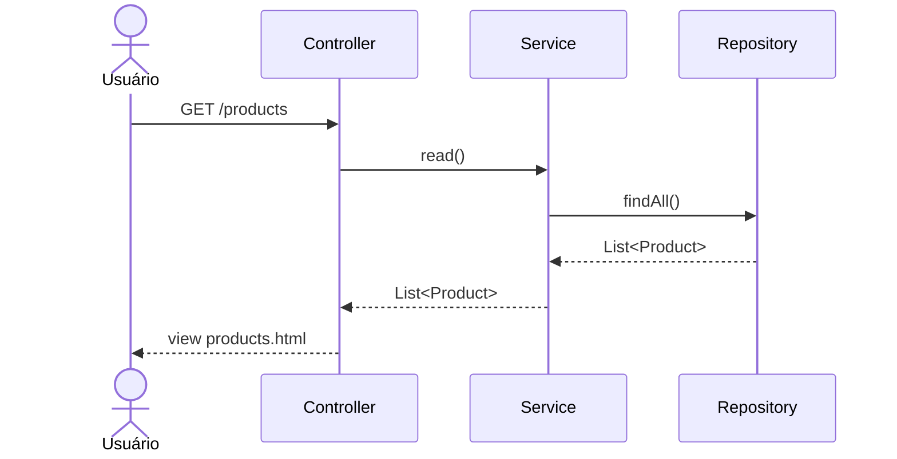
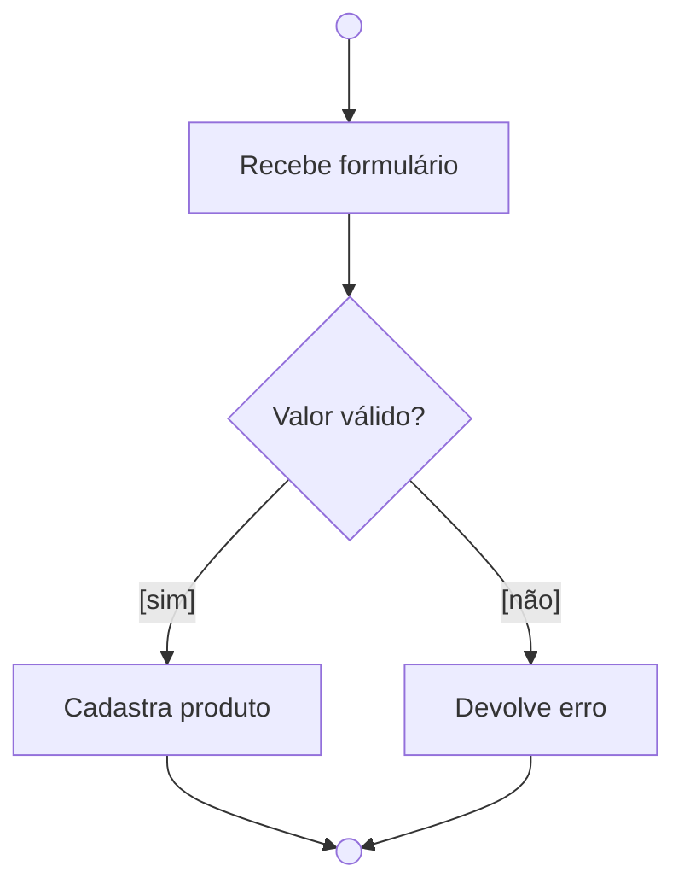
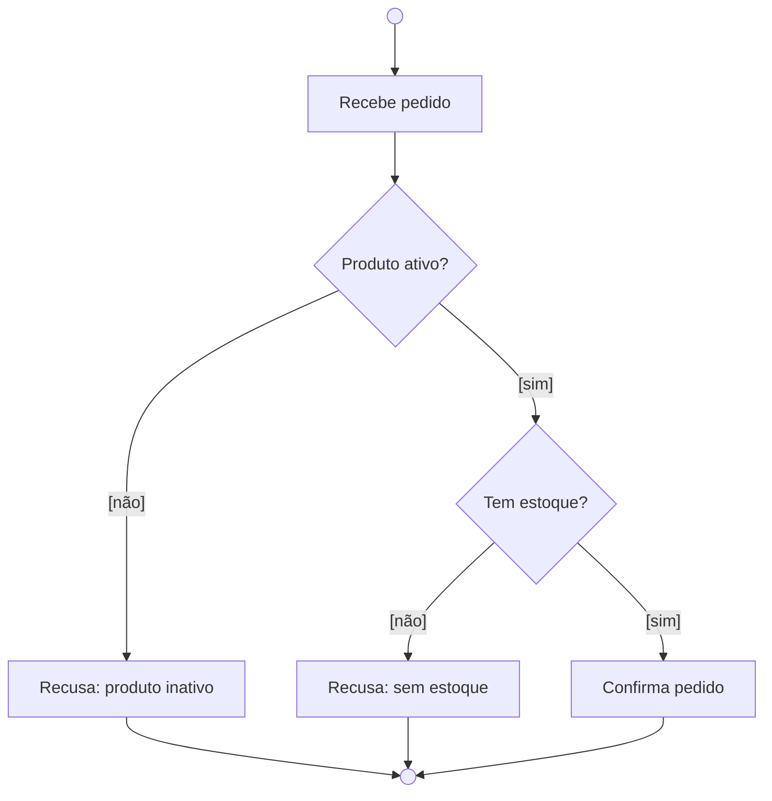
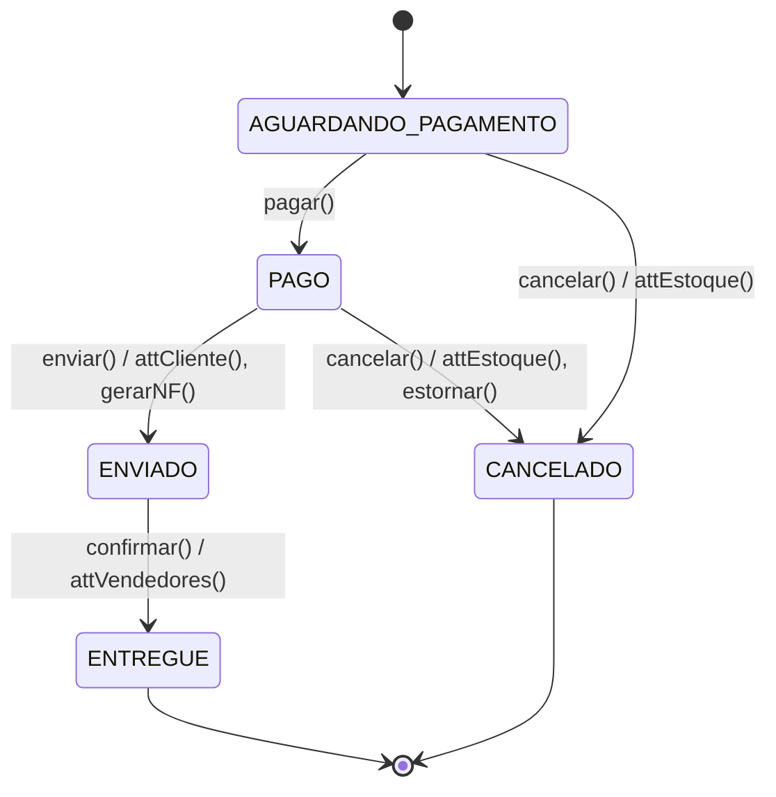
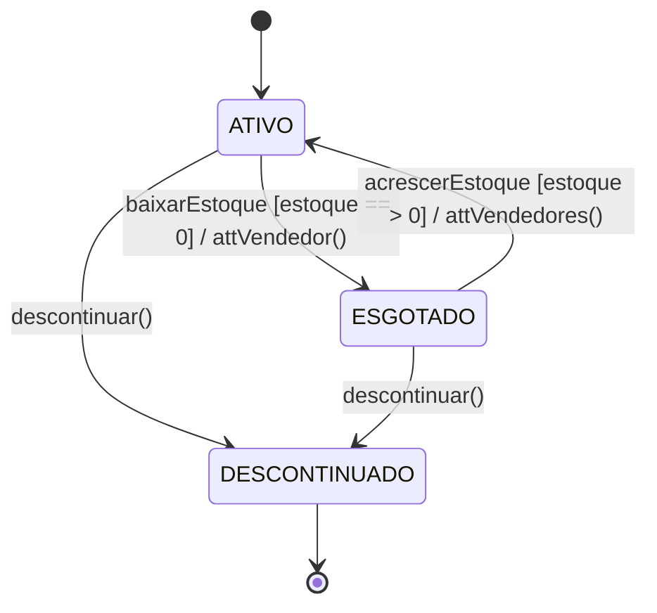

# Aula 6 — Estruturas Dinâmicas: Sequência, Atividades e Estados

> **Disciplina:** Arquitetura de Software  
> **Professor:** Prof. Dr. Pedro Henrique Nogueira Pizzutti  
> **Contexto:** Modelagem comportamental e dinâmica aplicada à arquitetura MVC (Sistema de Vendas e Estoque)

---

## 1. Visão Geral: Estático (C4) vs. Dinâmico

O modelo C4 (visto nas Aulas 2 e 4) organiza a arquitetura sob um ponto de vista **estático**: define quem são os atores, quais contêineres compõem o sistema e como os componentes estão distribuídos (Controllers, Services, Repositories).

Porém, sistemas reais operam em constante mutação. É indispensável compreender a arquitetura sob uma perspectiva **dinâmica**:
- Como uma execução acontece cronologicamente?
- Como as regras de negócio decidem bifurcações de fluxo?
- Como o ciclo de vida de uma entidade crítica é alterado por eventos?

Para responder a essas necessidades, a Aula 6 explora três diagramas comportamentais fundamentais:

| Diagrama | Pergunta Central | Foco Principal | Eixo | Melhor Aplicação |
|---|---|---|---|---|
| **Sequência** | *Quem chama quem, e em que ordem?* | Troca de mensagens | Tempo | Mapeamento de APIs, chamadas entre camadas/serviços e cenários de uso |
| **Atividades** | *Quais passos o processo executa?* | Lógica e bifurcações | Fluxo de controle | Algoritmos, regras de validação complexas e fluxos de negócio |
| **Estados** | *Em que estado o objeto está, e como muda?* | Ciclo de vida da entidade | Resposta a eventos | Entidades centrais do domínio (ex.: Pedido, Produto) |

---

## 2. Diagrama de Sequência

### Conceito e Notação
O diagrama de sequência descreve a troca cronológica de mensagens entre participantes:
- **Linha de vida:** Coluna vertical pontilhada indicando a existência do participante no tempo.
- **Ativação:** Bloco sobre a linha de vida representando o período em que o participante está processando a lógica.
- **Mensagem:** Seta contínua horizontal indicando chamada de método, requisição HTTP ou comunicação.
- **Retorno:** Seta tracejada representando a resposta do processamento ao emissor.

### Cenário 1: Cadastrar um Produto (`POST /products`)
Fluxo de escrita onde o usuário envia os dados, passando por Controller, Service e Repository, culminando em um redirecionamento HTTP.

### Cenário 2: Consulta e Renderização Disparada pelo Redirect (`GET /products`)
Fluxo de leitura disparado após o redirecionamento para consultar os produtos e devolver a visualização HTML renderizada.

---

## 3. Diagrama de Atividades

### Conceito e Notação
O diagrama de atividades detalha os passos de um algoritmo ou processo de negócio, evidenciando caminhos de sucesso e de exceção:
- **Nó Inicial:** Círculo preto preenchido; marca o início do processo.
- **Ação:** Retângulo com cantos arredondados contendo a tarefa ou etapa de processamento.
- **Decisão:** Losango com uma condição, de onde saem ramificações rotuladas (`[sim]`, `[não]`).
- **Nó Final:** Círculo preto com anel externo; indica o encerramento do fluxo.

### Cenário 1: Cadastro com Validação de Formulário
Modelagem das validações dos dados recebidos antes de persistir o produto no banco ou retornar erro.

### Cenário 2: Fechar um Pedido (Regras de Estoque e Catálogo)
Modelagem do processamento de um pedido com múltiplas decisões de negócio (produto ativo no catálogo e saldo de estoque disponível).

---

## 4. Diagrama de Estados

### Conceito e Notação
O diagrama de estados modela o ciclo de vida completo de uma entidade do domínio ao longo do tempo:
- **Estado Inicial:** Ponto em que o objeto passa a existir no sistema.
- **Estado:** Condição estável na qual o objeto permanece até que um evento ocorra.
- **Transição:** Seta rotulada no padrão `evento [condição] / ação` ligando um estado de origem ao de destino.
- **Estado Final:** Conclusão do ciclo de vida da entidade.

### Cenário 1: Ciclo de Vida da Entidade Pedido
Acompanhamento dos estados de um pedido desde a criação até a entrega ou cancelamento (com estorno e devolução ao estoque).

### Cenário 2: Ciclo de Vida da Entidade Produto
Transição de disponibilidade do produto de acordo com a movimentação de estoque ou descontinuação.

---

## 5. Como Escolher o Diagrama Correto

Ao projetar uma funcionalidade na arquitetura de software:

1. **Use Sequência** quando precisar definir o contrato e a colaboração entre componentes/camadas (Controller -> Service -> Repository) ou microsserviços ao longo de uma chamada cronológica.
2. **Use Atividades** quando precisar documentar regras de negócio com múltiplos `ifs`, validações, fluxos alternativos e tratamentos de erro dentro de um processo.
3. **Use Estados** quando uma entidade do banco de dados (ex.: Pedido, Matrícula, Produto) possuir um atributo `status` que determina quais operações são permitidas em cada fase do seu ciclo de vida.

---

## 6. Arquivos Mermaid (.mmd) nesta Pasta

- [`diagrama-sequencia.mmd`](diagrama-sequencia.mmd) — Diagrama de sequência do cadastro de produto (`POST /products`).
- [`diagrama-sequencia-leitura.mmd`](diagrama-sequencia-leitura.mmd) — Diagrama de sequência da listagem disparada pelo redirect (`GET /products`).
- [`diagrama-atividade.mmd`](diagrama-atividade.mmd) — Diagrama de atividade de validação no cadastro.
- [`diagrama-atividade-pedido.mmd`](diagrama-atividade-pedido.mmd) — Diagrama de atividade para fechamento de pedido com validações de negócio.
- [`diagrama-estado.mmd`](diagrama-estado.mmd) — Diagrama de estados com o ciclo de vida completo do Pedido.
- [`diagrama-estado-produto.mmd`](diagrama-estado-produto.mmd) — Diagrama de estados para disponibilidade e ciclo de vida do Produto.
