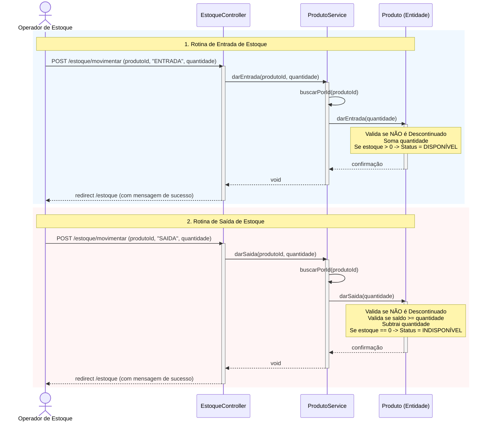
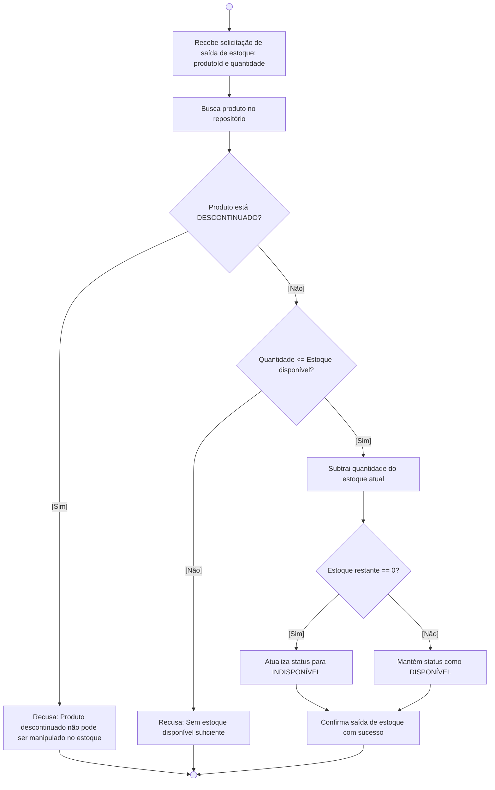
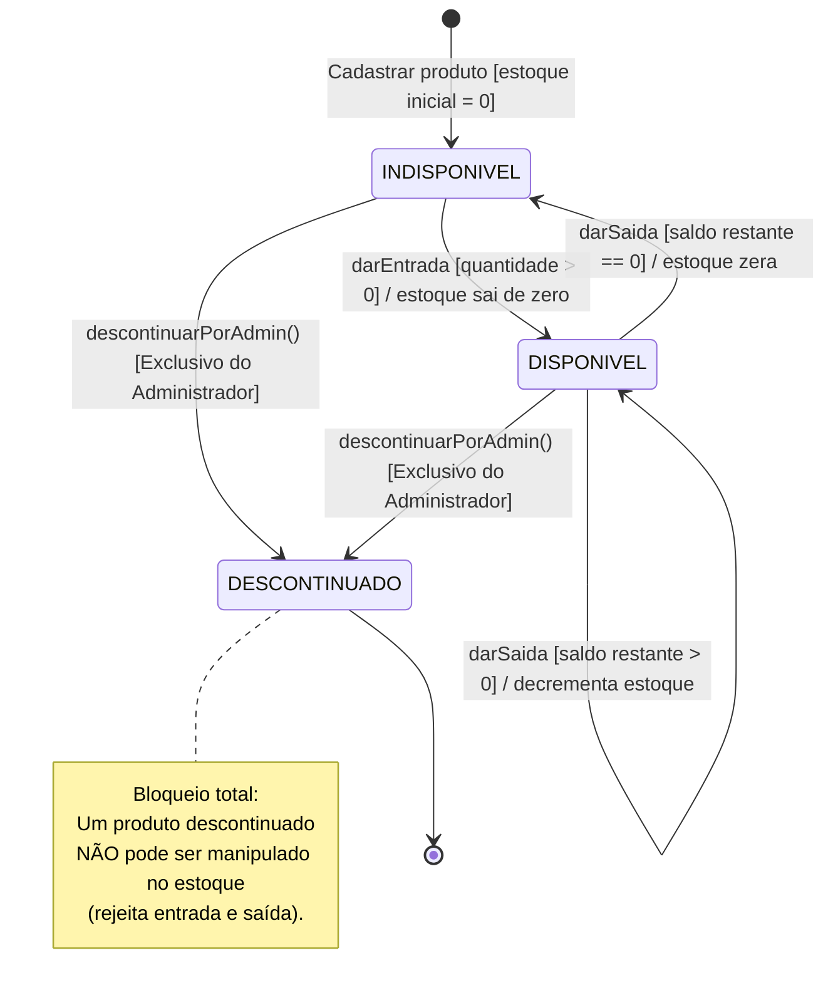

# Aula 6 — Estruturas Dinâmicas & Módulo de Estoque

> **Disciplina:** Arquitetura de Software  
> **Professor:** Prof. Dr. Pedro Henrique Nogueira Pizzutti  
> **Atividade:** Implementação do Módulo de Estoque no padrão MVC e Modelagem Dinâmica (Sequência, Atividades e Estados).

---

## 1. Atividade: Módulo de Estoque (Implementação MVC)

### Descrição e Regras de Negócio
No sistema de vendas e estoque:
1. **Status do Produto:** O produto possui os status `DISPONIVEL`, `INDISPONIVEL` e `DESCONTINUADO`.
2. **Criação:** Ao criar um produto, ele começa com estoque 0 e status **`INDISPONIVEL`**.
3. **Exclusividade do Administrador:** Apenas o **ADM** pode descontinuar um produto.
4. **Bloqueio de Manipulação:** Um produto com status **`DESCONTINUADO`** **não pode** ser manipulado no estoque (rejeita entrada e saída).
5. **Transições de Estoque:**
   - **Entrada:** Quando o estoque sai de zero (estoque > 0), o status passa para **`DISPONIVEL`**.
   - **Saída:** Quando o estoque zera (estoque == 0), o status passa para **`INDISPONIVEL`**.
   - **Validação de Saldo:** Não é permitida saída sem estoque disponível suficiente.

### Projeto MVC Implementado
O código-fonte completo está localizado na pasta [`mvc-estoque/`](mvc-estoque/):
- **Modelo:** [`Produto.java`](mvc-estoque/src/main/java/br/com/empresa/estoque/model/Produto.java) e [`StatusProduto.java`](mvc-estoque/src/main/java/br/com/empresa/estoque/model/StatusProduto.java) contendo as regras de negócio e validações de invariantes.
- **Serviço:** [`ProdutoService.java`](mvc-estoque/src/main/java/br/com/empresa/estoque/service/ProdutoService.java) gerenciando operações de catálogo e movimentação.
- **Controllers:**
  - [`ProdutoController.java`](mvc-estoque/src/main/java/br/com/empresa/estoque/controller/ProdutoController.java): Tela e rotina de produtos (`/produtos`), cadastro inicial e descontinuação por ADM.
  - [`EstoqueController.java`](mvc-estoque/src/main/java/br/com/empresa/estoque/controller/EstoqueController.java): Tela e rotina de movimentação de estoque (`/estoque`).
- **Telas Thymeleaf:**
  - [`produtos.html`](mvc-estoque/src/main/resources/templates/produtos.html): Listagem com badges de status, botão de descontinuar exclusivo de ADM e formulário de cadastro.
  - [`estoque.html`](mvc-estoque/src/main/resources/templates/estoque.html): Formulário de lançamento de entrada/saída com feedback visual de validações.
- **Testes Automatizados:** [`ProdutoTest.java`](mvc-estoque/src/test/java/br/com/empresa/estoque/ProdutoTest.java) cobrindo 100% das transições de status e regras de negócio.

---

## 2. Diagrama de Sequência: Rotina de Entrada e Saída de Estoque

Arquivo fonte: [`diagrama-sequencia-estoque.mermaid`](diagrama-sequencia-estoque.mermaid) / [`diagrama-sequencia-estoque.mmd`](diagrama-sequencia-estoque.mmd)



---

## 3. Diagrama de Atividades: Fluxo de Saída de Estoque

Validação restritiva: impede a saída se o produto estiver descontinuado ou se a quantidade solicitada for maior que o saldo em estoque.

Arquivo fonte: [`diagrama-atividade-saida-estoque.mermaid`](diagrama-atividade-saida-estoque.mermaid) / [`diagrama-atividade-saida-estoque.mmd`](diagrama-atividade-saida-estoque.mmd)



---

## 4. Diagrama de Estados: Ciclo de Vida do Produto

Mapeamento completo dos status `DISPONIVEL`, `INDISPONIVEL` e `DESCONTINUADO`:
- Transição inicial para `INDISPONIVEL` com estoque 0.
- Transições de estoque saindo de zero e zerando.
- Transição exclusiva de Administrador para `DESCONTINUADO`.

Arquivo fonte: [`diagrama-estados-produto.mermaid`](diagrama-estados-produto.mermaid) / [`diagrama-estados-produto.mmd`](diagrama-estados-produto.mmd)



---

## 5. Como Executar o Módulo de Estoque

```bash
cd Aula-06/mvc-estoque
./mvnw test               # Executa os 7 testes automatizados
./mvnw spring-boot:run     # Inicia o servidor na porta 8080
```
- Acessar Catálogo de Produtos: `http://localhost:8080/produtos`
- Acessar Movimentação de Estoque: `http://localhost:8080/estoque`
