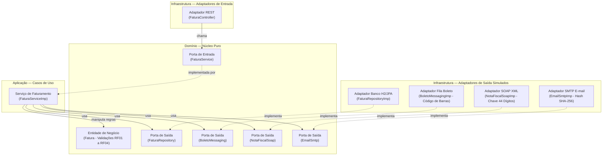
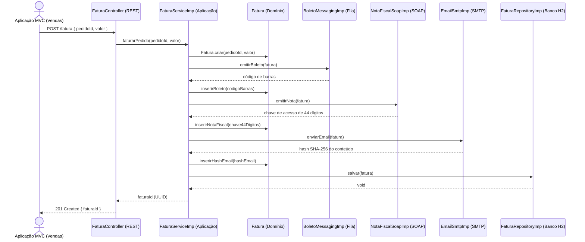

# Aula 7 — Arquitetura Hexagonal: Faturando um Pedido no Hub de Integrações

> **Disciplina:** Arquitetura de Software  
> **Professor:** Prof. Dr. Pedro Henrique Nogueira Pizzutti  
> **Atividade:** Implementação do Hub de Integrações na Arquitetura Hexagonal com Portas, Adaptadores e Regras de Negócio (RF01 a RF04).

---

## 1. Requisitos da Atividade

A implementação do Hub de Integrações na arquitetura hexagonal cumpre rigorosamente os seguintes requisitos:

* **RF01:** Ao receber um pedido, o hub deve criar e persistir a fatura e devolver o ID (UUID) à camada REST.
* **RF02:** Ao faturar um pedido, o hub deve emitir o boleto, por fila.  
  *Restrição:* O boleto emitido deve gerar um **código de barras**, guardado na fatura.
* **RF03:** Ao faturar um pedido, o hub deve emitir a nota fiscal, por SOAP.  
  *Restrição:* A nota emitida deve gerar uma **chave de acesso de 44 dígitos**, guardada na fatura.
* **RF04:** Ao faturar um pedido, o hub deve notificar o cliente por e-mail, por SMTP.  
  *Restrição:* O e-mail enviado deve gerar um **hash do conteúdo**, guardado na fatura.
* **Observação:** As portas de saída foram implementadas com adaptadores simulados na camada de infraestrutura.

---

## 2. O Problema do Hub de Integrações e Limitações do MVC

Na modelagem do sistema comercial, a aplicação MVC precisa faturar pedidos fechados através de um **Hub de Integrações** externo.

Quando um pedido é fechado, o processo de faturamento precisa se comunicar com múltiplos provedores e tecnologias externas heterogêneas:
- **Aplicação MVC:** Envia o pedido fechado via **HTTP/REST**.
- **Emissor de Boleto:** Publica solicitação em **Fila de Pedidos** e consome retorno em **Fila de Retorno**.
- **Emissor de Nota Fiscal:** Emite a nota fiscal via protocolo **SOAP/XML**.
- **Serviço de E-mail:** Envia o boleto e a nota fiscal ao cliente via protocolo **SMTP**.
- **Banco de Dados:** Persiste o registro da fatura via **SQL/JPA**.

### Por que o padrão MVC não atende bem a esse cenário?
Se tentássemos estruturar esse hub no modelo MVC tradicional:
- **View:** O hub é um serviço puramente integrador e sem interface gráfica de usuário; a camada View ficaria ociosa e sem propósito.
- **Controller:** É projetado para receber requisições HTTP da web. Mas e o retorno assíncrono do boleto que chega por mensageria (RabbitMQ, Kafka, SQS)? O Controller tradicional não se adequa a esse mecanismo de entrada.
- **Service:** As regras puras de cálculo e faturamento acabariam misturadas com código de serialização XML, clientes SOAP, APIs de e-mail e clientes de fila, tornando a manutenção e os testes unitários um pesadelo.
- **Repository:** Foi concebido para comunicação com o banco de dados. Os sistemas externos de mensageria, SOAP e SMTP ficariam sem lugar arquitetural adequado.

> **Conclusão:** O hub até cabe no MVC, mas de forma forçada e espremida dentro do Model. Para resolver esse acoplamento, adotamos a **Arquitetura Hexagonal**.

---

## 3. Estrutura do Hexágono por Dentro

A arquitetura do Hub de Integração é dividida em três anéis concêntricos:



### 1. Domínio (`br.com.hexagonal.domain`)
* **Entidade ([`Fatura.java`](hexagonal/src/main/java/br/com/hexagonal/domain/entities/Fatura.java)):** POJO Java puro sem dependências externas. Garante validações de negócio:
  - Pedido válido e valor maior que zero.
  - `inserirBoleto(codigoBarras)`: Valida e armazena o código de barras (RF02).
  - `inserirNotaFiscal(chaveAcesso44Digitos)`: Valida a restrição de exatamente **44 dígitos numéricos** da NF-e (RF03).
  - `inserirHashEmail(hashEmail)`: Valida e armazena o hash do conteúdo do e-mail (RF04).
* **Porta de Entrada ([`FaturaService.java`](hexagonal/src/main/java/br/com/hexagonal/domain/ports/in/FaturaService.java)):** Declara `UUID faturarPedido(Long pedidoId, BigDecimal valor)`.
* **Portas de Saída (`ports.out`):**
  - [`FaturaRepository.java`](hexagonal/src/main/java/br/com/hexagonal/domain/ports/out/persistence/FaturaRepository.java): Salvar fatura no banco (RF01).
  - [`BoletoMessaging.java`](hexagonal/src/main/java/br/com/hexagonal/domain/ports/out/messaging/BoletoMessaging.java): Emitir boleto via mensageria (RF02).
  - [`NotaFiscalSoap.java`](hexagonal/src/main/java/br/com/hexagonal/domain/ports/out/soap/NotaFiscalSoap.java): Emitir nota fiscal via SOAP (RF03).
  - [`EmailSmtp.java`](hexagonal/src/main/java/br/com/hexagonal/domain/ports/out/smtp/EmailSmtp.java): Notificar cliente via SMTP (RF04).

### 2. Aplicação (`br.com.hexagonal.application`)
* **Serviço ([`FaturaServiceImp.java`](hexagonal/src/main/java/br/com/hexagonal/application/FaturaServiceImp.java)):** Implementa a porta de entrada e coordena as 4 portas de saída, desacoplado de qualquer framework ou tecnologia.

### 3. Infraestrutura (`br.com.hexagonal.infra.adapters`)
* **Adaptador REST de Entrada ([`FaturaController.java`](hexagonal/src/main/java/br/com/hexagonal/infra/adapters/in/rest/controllers/FaturaController.java)):** Endpoint `POST /fatura` devolvendo HTTP 201 com `faturaId`.
* **Adaptadores de Saída Simulados:**
  - [`BoletoMessagingImp.java`](hexagonal/src/main/java/br/com/hexagonal/infra/adapters/out/messaging/BoletoMessagingImp.java): Simula fila e gera linha digitável do código de barras.
  - [`NotaFiscalSoapImp.java`](hexagonal/src/main/java/br/com/hexagonal/infra/adapters/out/soap/NotaFiscalSoapImp.java): Simula chamada SOAP XML e gera a **chave de acesso de 44 dígitos** (padrão SEFAZ: cUF, AAMM, CNPJ, mod 55, serie, nNF, tpEmis, cNF, cDV).
  - [`EmailSmtpImp.java`](hexagonal/src/main/java/br/com/hexagonal/infra/adapters/out/smtp/EmailSmtpImp.java): Simula envio SMTP e gera o **hash criptográfico SHA-256** do conteúdo.
  - [`FaturaRepositoryImp.java`](hexagonal/src/main/java/br/com/hexagonal/infra/adapters/out/persistence/FaturaRepositoryImp.java): Mapeia para JPA e persiste no banco H2.

---

## 4. Fluxo de Execução do Faturamento



---

## 5. Como Executar e Testar

```bash
cd Aula-07/hexagonal
./mvnw test               # Executa os 7 testes automatizados (unitários e integrados)
./mvnw spring-boot:run     # Inicia o servidor na porta 8081
```

### Teste via cURL:
```bash
curl -X POST http://localhost:8081/fatura \
  -H "Content-Type: application/json" \
  -d '{"pedidoId": 105, "valor": 389.90}'
```
**Resposta (HTTP 201 Created):**
```json
{
  "faturaId": "a5c7f89d-43b2-4d1a-8e2b-1c5f89e47a21"
}
```

Acesso ao Console do Banco H2: `http://localhost:8081/h2-console` (JDBC URL: `jdbc:h2:file:./db/database`, User: `sa`).
