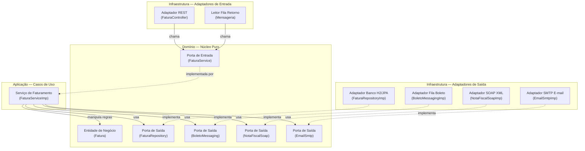
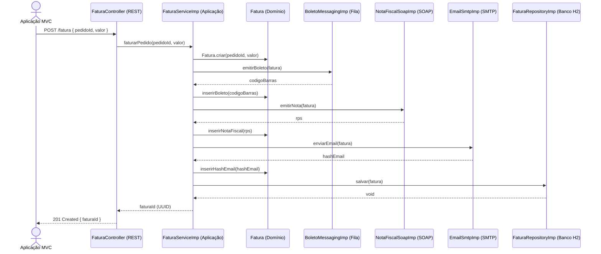

# Aula 7 — Arquitetura Hexagonal: Portas, Adaptadores e o Núcleo Independente

> **Disciplina:** Arquitetura de Software  
> **Professor:** Prof. Dr. Pedro Henrique Nogueira Pizzutti  
> **Contexto:** Hub de Integrações e Faturamento de Pedidos

---

## 1. O Problema do Hub de Integrações

Na modelagem do nosso sistema (iniciada no C4 das Aulas 2 e 4 e continuada nas Aulas 5 e 6), a aplicação MVC precisa faturar pedidos fechados através de um **Hub de Integrações** externo.

Quando um pedido é fechado, o processo de faturamento precisa se comunicar com múltiplos provedores e tecnologias externas heterogêneas:
- **Aplicação MVC:** Envia o pedido fechado via **HTTP/REST**.
- **Emissor de Boleto:** Publica solicitação em **Fila de Pedidos** e consome retorno em **Fila de Retorno**.
- **Emissor de Nota Fiscal:** Emite a nota fiscal via protocolo **SOAP/XML**.
- **Serviço de E-mail:** Envia o boleto e a nota fiscal ao cliente via protocolo **SMTP**.
- **Banco de Dados:** Persiste o registro da fatura via **SQL/JPA**.

### Por que o padrão MVC não atende bem a esse cenário?
Se tentássemos estruturar esse hub no modelo MVC tradicional:
- **View:** O hub é um serviço puramente integrador e sem interface gráfica de usuário; a camada View ficaria ociosa e sem propósito.
- **Controller:** É projetado para receber requisições HTTP da web. Mas e o retorno assíncrono do boleto que chega por mensageria (RabbitMQ, Kafka, SQS)? O Controller tradicional não se adequa a esse mecanismo de entrada.
- **Service:** As regras puras de cálculo e faturamento acabariam misturadas com código de serialização XML, clientes SOAP, APIs de e-mail e clientes de fila, tornando a manutenção e os testes unitários um pesadelo.
- **Repository:** Foi concebido para comunicação com o banco de dados. Os sistemas externos de mensageria, SOAP e SMTP ficariam sem lugar arquitetural adequado.

> **Conclusão:** O hub até cabe no MVC, mas de forma forçada e espremida dentro do Model. Para resolver esse acoplamento, adotamos a **Arquitetura Hexagonal**.

---

## 2. Linha do Tempo: A Evolução das Arquiteturas Orientadas a Domínio

A Arquitetura Hexagonal faz parte de um movimento arquitetural que trocou a divisão tradicional de "cima e baixo" (camadas clássicas) por **"dentro e fora"**:

| Ano | Autor | Abordagem | Contribuição Central |
|---|---|---|---|
| **2003** | Eric Evans | **Domain-Driven Design (DDD)** | Isolou as regras de negócio no Domínio e criou a linguagem ubíqua, embora a infraestrutura ainda permanecesse na base das camadas. |
| **2005** | Alistair Cockburn | **Arquitetura Hexagonal (Ports & Adapters)** | Trocou camadas por portas e adaptadores. O núcleo define as interfaces (portas); qualquer tecnologia é apenas um detalhe intercambiável (adaptador). |
| **2008** | Jeffrey Palermo | **Arquitetura em Cebola (Onion Architecture)** | Organizou o "lado de dentro" em anéis concêntricos (Modelo de Domínio $\rightarrow$ Serviços de Domínio $\rightarrow$ Serviços de Aplicação). |
| **2012** | Robert C. Martin (Uncle Bob) | **Arquitetura Limpa (Clean Architecture)** | Consolidou as propostas anteriores e enunciou formalmente a **Regra de Dependência**: *o código de dentro nunca pode conhecer o código de fora*. |

---

## 3. O Hexágono por Dentro

A arquitetura do Hub de Integração é dividida em três anéis concêntricos:



### 1. Domínio (`br.com.hexagonal.domain`)
* **Entidade (`Fatura`):** POJO Java puro sem anotações de frameworks. Garante invariantes de negócio (pedido não nulo, valor positivo) e métodos de domínio (`inserirBoleto`, `inserirNotaFiscal`, `inserirHashEmail`).
* **Porta de Entrada (`ports.in.FaturaService`):** Interface que declara o que o hub oferece ao mundo externo (`UUID faturarPedido(Long pedidoId, BigDecimal valor)`).
* **Portas de Saída (`ports.out`):** Interfaces declarando o que o hub necessita:
  * `FaturaRepository`: salvar fatura no banco.
  * `BoletoMessaging`: emitir boleto via fila.
  * `NotaFiscalSoap`: emitir nota fiscal via SOAP.
  * `EmailSmtp`: enviar notificação por e-mail via SMTP.

### 2. Aplicação (`br.com.hexagonal.application`)
* **Serviço (`FaturaServiceImp`):** Implementa a porta de entrada `FaturaService` e orquestra o fluxo de negócio injetando exclusivamente as interfaces das portas de saída.
* Não conhece tecnologias concretas, banco de dados, bibliotecas HTTP ou detalhes de rede.

### 3. Infraestrutura (`br.com.hexagonal.infra.adapters`)
* **Adaptadores de Entrada (`in.rest`):** `FaturaController` recebe a requisição HTTP `POST /fatura`, desserializa o DTO `FaturaPostRequest` e aciona a porta de entrada.
* **Adaptadores de Saída (`out`):**
  * `persistence.FaturaRepositoryImp`: Converte entidade de domínio para entidade JPA (`FaturaEntityJpa`) e salva no banco H2.
  * `messaging.BoletoMessagingImp`: Simula envio à fila e geração do código de barras.
  * `soap.NotaFiscalSoapImp`: Simula chamada SOAP/XML para serviço municipal/estadual de NFS-e.
  * `smtp.EmailSmtpImp`: Simula envio de e-mail ao cliente.

---

## 4. A Regra de Dependência e Inversão de Controle

```
[ Infraestrutura ] ──(conhece)──> [ Aplicação ] ──(conhece)──> [ Domínio ]
        │                                                              ▲
        └────────────────────────(conhece)─────────────────────────────┘
```

* **Domínio** só conhece a si mesmo (dependência zero).
* **Aplicação** conhece apenas o Domínio.
* **Infraestrutura** conhece a Aplicação e o Domínio.

> **Inversão de Dependência:** As portas de saída são contratos pertencentes ao **Domínio**. Os adaptadores técnicos na camada externa de **Infraestrutura** é que se adaptam e implementam esses contratos. Se o banco trocar de H2 para PostgreSQL, ou a mensageria de RabbitMQ para AWS SQS, **nenhuma linha do domínio ou da aplicação é alterada**.

---

## 5. Fluxo de Execução do Faturamento



---

## 6. Quando Usar MVC vs. Hexagonal

| Critério | Escolha MVC | Escolha Hexagonal |
|---|---|---|
| **Interface com Usuário** | Sistema possui telas (Thymeleaf, JSP) ou CRUDs web diretos | Sistema é um serviço de backend/hub sem telas |
| **Protocolos** | Apenas requisições HTTP web e banco relacional | Múltiplos protocolos (REST, Filas, SOAP, SMTP, gRPC) |
| **Complexidade de Regras** | Regras simples de cadastro e listagem | Regras de negócio ricas e validações críticas de domínio |
| **Evolução Tecnológica** | Banco e serviços são estáveis | Integrações externas mudam de fornecedor com frequência |
| **Testabilidade** | Testes integrados com servidor e banco | Testes unitários puros ultrarrápidos sem levantar framework |

---

## 7. Como Executar e Testar o Projeto

### Pré-requisitos
* Java 17+ (ou Java 21)
* Maven Wrapper incluído no projeto (`./mvnw` ou `mvnw.cmd`)

### Execução dos Testes Automatizados
```bash
cd Aula-07/hexagonal
./mvnw test
```
* **Testes de Domínio:** [`FaturaTest.java`](hexagonal/src/test/java/br/com/hexagonal/domain/entities/FaturaTest.java) testa validações de regras e invariantes de forma isolada.
* **Testes de Integração:** [`HexagonalApplicationTests.java`](hexagonal/src/test/java/br/com/hexagonal/HexagonalApplicationTests.java) valida o ciclo completo de injeção de dependências e faturamento.

### Inicialização do Servidor
```bash
./mvnw spring-boot:run
```
A aplicação iniciará na porta **8081** (configurada em `application.properties`).

### Chamada HTTP para Faturar Pedido
```bash
curl -X POST http://localhost:8081/fatura \
  -H "Content-Type: application/json" \
  -d '{"pedidoId": 1234, "valor": 349.90}'
```
**Resposta esperada (HTTP 201 Created):**
```json
{
  "faturaId": "a1b2c3d4-e5f6-7890-abcd-ef1234567890"
}
```

### Acesso ao Banco de Dados H2
* **URL:** `http://localhost:8081/h2-console`
* **JDBC URL:** `jdbc:h2:file:./db/database`
* **User:** `sa` / **Password:** *(vazio)*
