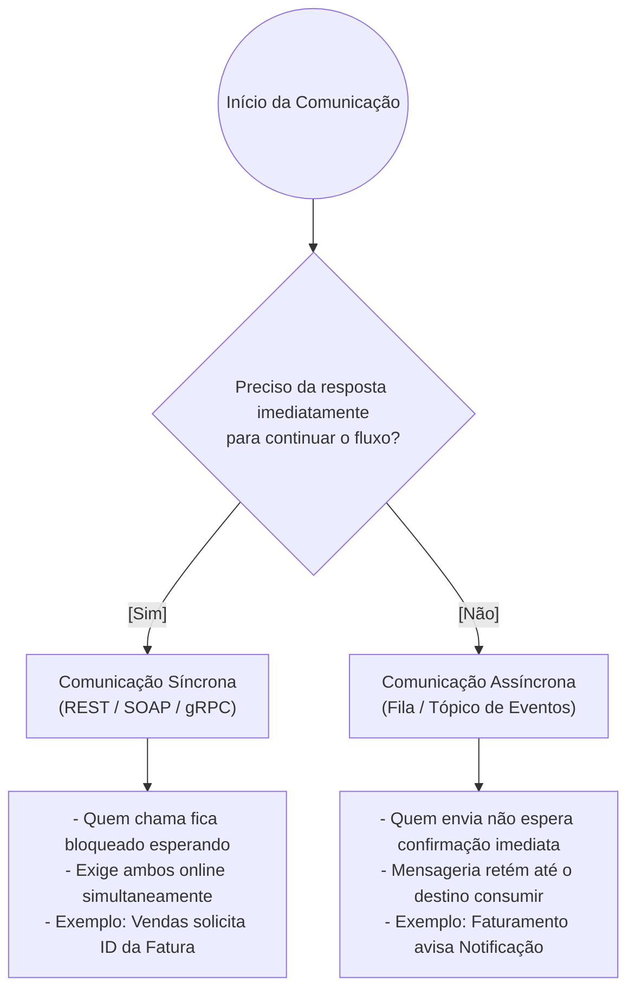
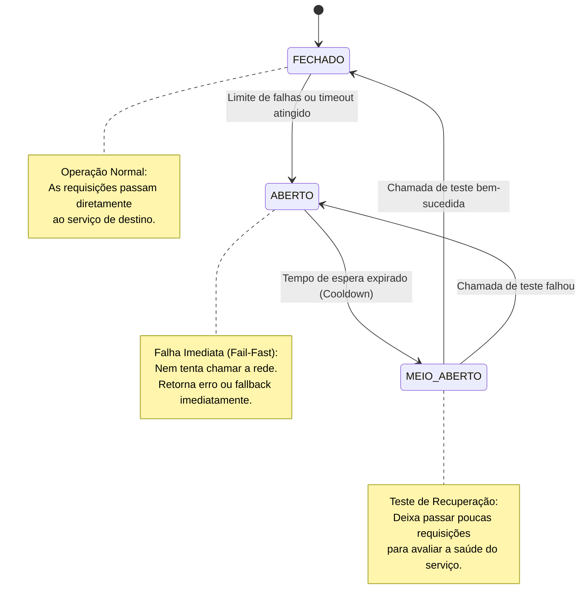
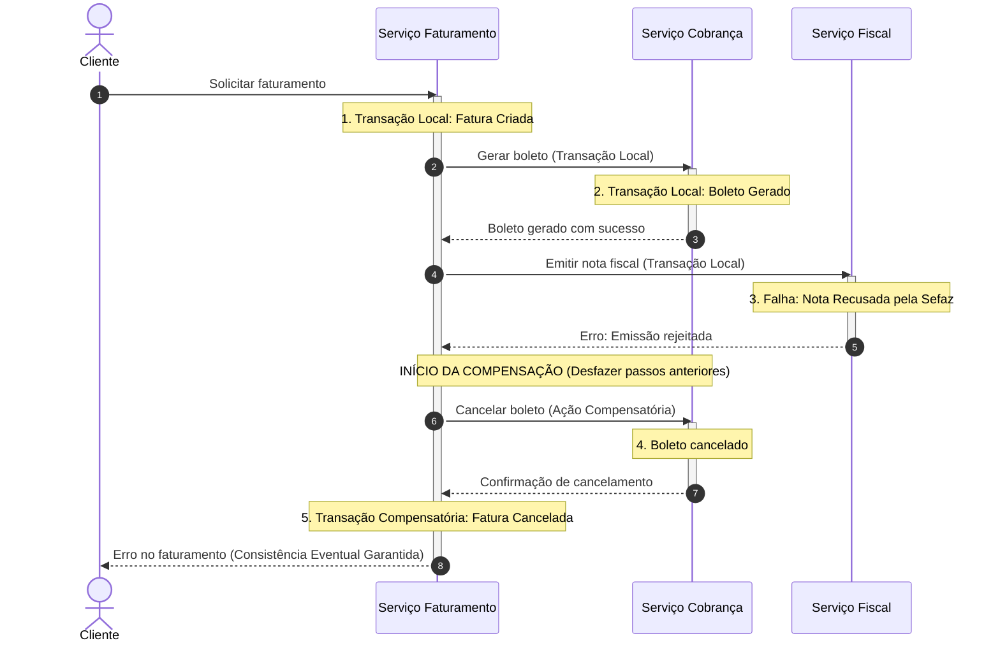

# Aula 8 — Arquitetura de Microsserviços & Integração da Venda ao Hub

> **Disciplina:** Arquitetura de Software  
> **Professor:** Prof. Dr. Pedro Henrique Nogueira Pizzutti  
> **Tema:** Sistemas Distribuídos, Decomposição por Capacidades de Negócio e os Desafios da Rede  
> **Atividade:** Implementação da chamada REST da Venda ao Hub Hexagonal e Análise dos Problemas da Rede

---

## 1. Atividade: Integrando a Venda ao Hub de Faturamento

### Descrição da Implementação
No ecossistema de microsserviços, a aplicação de vendas em MVC ([`mvc-vendas/`](mvc-vendas/)) foi integrada ao Hub de Faturamento Hexagonal (desenvolvido na Aula 7):
1. **Chamada REST:** Ao fechar um pedido (`POST /pedidos/{id}/fechar`), a aplicação de Vendas aciona o cliente HTTP ([`HubFaturamentoClient.java`](mvc-vendas/src/main/java/br/com/empresa/vendas/client/HubFaturamentoClient.java)) enviando os dados do pedido (`pedidoId` e `valorTotal`) para o endpoint `POST http://localhost:8081/fatura`.
2. **Guarda do ID da Fatura:** O Hub processa as regras de negócio, emite boleto, gera chave de 44 dígitos da NF-e, envia e-mail com hash e persiste no banco H2, retornando o `faturaId` (UUID).
3. **Persistência no Pedido:** O serviço de vendas guarda o ID da fatura devolvido no registro do pedido e atualiza o status para `FATURADO`.
4. **Interface Visual:** Tela Thymeleaf em [`pedidos.html`](mvc-vendas/src/main/resources/templates/pedidos.html) com listagem de pedidos, status e botão para fechar e faturar o pedido.
5. **Testes Automatizados:** [`PedidoServiceTest.java`](mvc-vendas/src/test/java/br/com/empresa/vendas/PedidoServiceTest.java) cobrindo sucesso, falha e prevenção de faturamento duplo.

---

## 2. Análise dos Problemas da Integração pela Rede

A análise completa detalhando o que acontece com o pedido, o que o negócio percebe e as soluções arquiteturais estudadas está disponível no documento:
👉 **[`analise-integracao-venda-hub.md`](analise-integracao-venda-hub.md)**

### Síntese dos Dois Problemas e Soluções:

| Problema na Rede | Comportamento no Pedido | Impacto no Negócio | Solução Arquitetural | Onde Atua |
|---|---|---|---|---|
| **1. Atraso e Falhas em Cascata** | A chamada REST síncrona bloqueia a thread de Vendas aguardando o Hub e terceiros (SEFAZ). O tempo estoura (*HTTP 504*), o pedido fica congelado e o pool de conexões se esgota. | Vendas travam; vendedores não conseguem atender clientes; o sistema comercial da empresa cai por lentidão de um parceiro externo. | **Timeout Estrito + Circuit Breaker (com Fallback)** | Na camada cliente HTTP de Vendas ([`HubFaturamentoClient`](mvc-vendas/src/main/java/br/com/empresa/vendas/client/HubFaturamentoClient.java)). |
| **2. Oscilação na Resposta e Repetição** | O Hub fatura com sucesso, mas a conexão oscila na volta da resposta. A venda não recebe o ID e dá erro na tela; o vendedor clica novamente em "Fechar Pedido", enviando uma segunda requisição. | **Faturamento duplicado:** o cliente recebe dois boletos e duas notas fiscais para a mesma compra. Atrito no SAC, retrabalho contábil e risco fiscal. | **Idempotência (com Chave de Negócio)** | No Hub Hexagonal ao validar se o `pedidoId` já possui fatura antes de gerar nova. |

---

## 3. Retomando o Estilo Distribuído: Do Monolito ao Ecossistema

Microsserviços não surgem do nada; eles são o resultado da evolução natural de um ecossistema de software:
- **Aulas 2, 4 e 5:** Construímos a aplicação MVC de **Vendas**, responsável pelo catálogo de produtos e registro de pedidos.
- **Aula 7:** Construímos o **Hub de Faturamento** com Arquitetura Hexagonal, conectando o MVC aos serviços externos (emissor de boletos, emissor de notas fiscais e servidor de e-mail).

Hoje, o Hub de Faturamento realiza três funções distintas: cobrança via boleto, emissão fiscal e notificação por e-mail. Se dividirmos esse hub em **microsserviços especializados**, conquistamos quatro benefícios cruciais:

1. **Deploy Independente:** Alterações nas regras de cobrança exigem publicar apenas o serviço de Cobrança, mantendo o restante do sistema no ar sem riscos.
2. **Escala sob Medida (Elasticidade Granular):** Em períodos de pico de vendas (como Black Friday), apenas o serviço de Notificação precisa ser escalado horizontalmente.
3. **Falha Isolada (Resiliência):** Se o servidor de e-mail cair, o processo de faturamento e a emissão das notas continuam operando normalmente.
4. **Times Autônomos:** Equipes diferentes assumem a responsabilidade ponta a ponta sobre serviços específicos.

---

## 4. O Ecossistema Dividido (C4 · Nível 2)

```mermaid
flowchart TD
    subgraph Internos ["Serviços Internos da Empresa (Microsserviços)"]
        Vendas["Vendas<br>(Aplicação MVC)"]
        Faturamento["Faturamento<br>(Hub Hexagonal)"]
        Cobranca["Cobrança<br>(Boletos)"]
        Fiscal["Fiscal<br>(Notas Fiscais)"]
        Notificacao["Notificação<br>(E-mails / Mensagens)"]
    end

    subgraph Externos ["Fora da Empresa (Serviços de Terceiros)"]
        BancoEmissor["Banco Emissor<br>(API Boleto)"]
        EmissorNota["Emissor da Nota<br>(Sefaz / Prefeitura)"]
        ServidorEmail["Servidor de E-mail<br>(SMTP)"]
    end

    Vendas -->|REST / HTTP (Síncrono)| Faturamento
    Faturamento -->|SOAP / XML (Síncrono)| Fiscal
    Faturamento -.->|Fila de Mensageria (Assíncrono)| Cobranca
    Faturamento -.->|Fila de Mensageria (Assíncrono)| Notificacao

    Cobranca -->|API Externa| BancoEmissor
    Fiscal -->|SOAP / WebService| EmissorNota
    Notificacao -->|SMTP| ServidorEmail
```

---

## 5. Como os Serviços Conversam: Síncrona vs. Assíncrona



---

## 6. Padrões de Resiliência: Circuit Breaker e Saga com Compensação

### Circuit Breaker (Disjuntor)


### Padrão Saga e Ações de Compensação


---

## 7. Como Executar a Aplicação de Vendas

```bash
cd Aula-08/mvc-vendas
./mvnw test               # Executa os 4 testes automatizados
./mvnw spring-boot:run     # Inicia o servidor na porta 8082
```
Acessar Gestão de Pedidos: `http://localhost:8082/pedidos`
