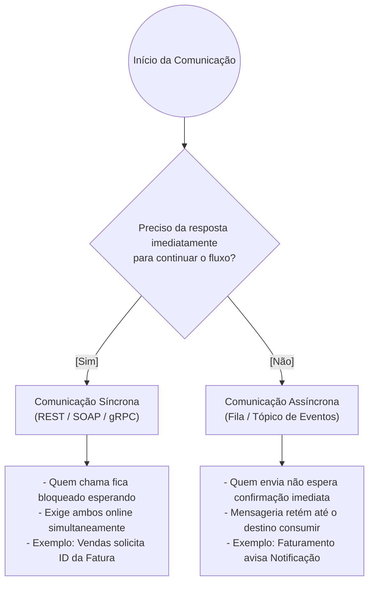
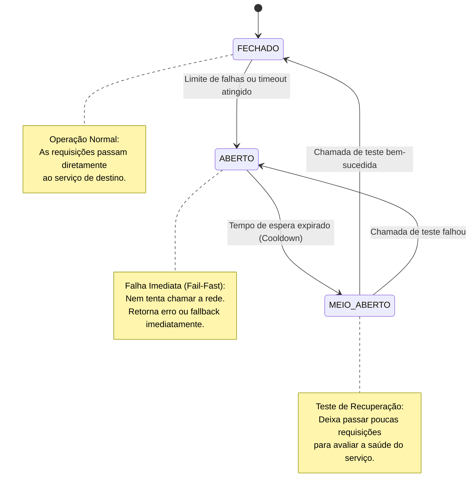
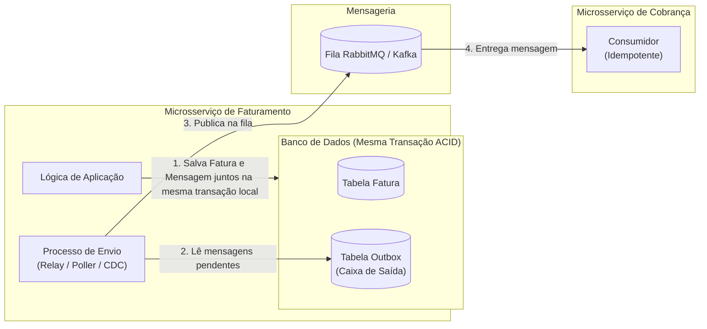
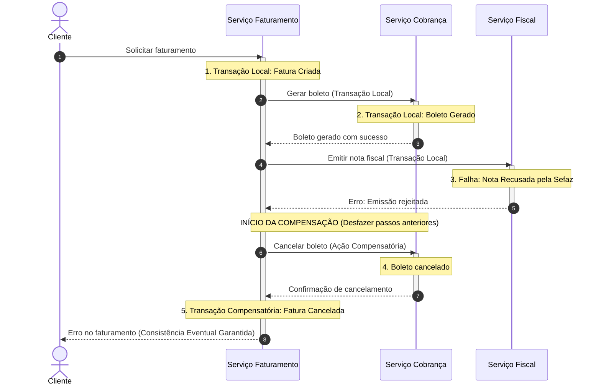

# Aula 8 — Arquitetura de Microsserviços: Um Sistema, Vários Serviços

> **Disciplina:** Arquitetura de Software  
> **Professor:** Prof. Dr. Pedro Henrique Nogueira Pizzutti  
> **Tema:** Sistemas Distribuídos, Decomposição por Capacidades de Negócio e os Desafios da Rede

---

## 1. Retomando o Estilo Distribuído: Do Monolito ao Ecossistema

Microsserviços não surgem do nada; eles são o resultado da evolução natural de um ecossistema de software:
- **Aulas 2, 4 e 5:** Construímos a aplicação MVC de **Vendas**, responsável pelo catálogo de produtos e registro de pedidos.
- **Aula 7:** Construímos o **Hub de Faturamento** com Arquitetura Hexagonal, conectando o MVC aos serviços externos (emissor de boletos, emissor de notas fiscais e servidor de e-mail).

Hoje, o Hub de Faturamento realiza três funções distintas: cobrança via boleto, emissão fiscal e notificação por e-mail. Se dividirmos esse hub em **microsserviços especializados**, conquistamos quatro benefícios cruciais:

1. **Deploy Independente:** Alterações nas regras de cobrança (ex.: novos prazos ou descontos no boleto) exigem publicar apenas o serviço de Cobrança, mantendo o restante do sistema no ar sem riscos.
2. **Escala sob Medida (Elasticidade Granular):** Em períodos de pico de vendas (como Black Friday), apenas o serviço de Notificação precisa ser escalado horizontalmente com mais instâncias para suportar o volume de disparos, sem desperdiçar recursos na emissão fiscal.
3. **Falha Isolada (Resiliência):** Se o servidor de e-mail cair, o processo de faturamento e a emissão das notas continuam operando normalmente.
4. **Times Autônomos:** Equipes diferentes assumem a responsabilidade ponta a ponta sobre serviços específicos, publicando em seu próprio ritmo e domínio.

---

## 2. O que é um Microsserviço?

Um sistema distribuído executa em múltiplas máquinas que se coordenam. Há duas formas principais de distribuí-lo:
* **Replicar (a mesma coisa em vários lugares):** Balanceador de carga distribuindo requisições entre cópias idênticas para suportar volume.
* **Dividir (coisas diferentes em lugares diferentes):** Cada parte do sistema é responsável por uma capacidade específica do negócio.

> ### A Definição Formal (James Lewis & Martin Fowler, 2014)
> *"Uma forma de construir uma aplicação como um conjunto de pequenos serviços. Cada um roda no seu próprio processo, conversa por mecanismos leves, é construído em torno de uma capacidade de negócio e pode ser implantado de forma independente."*
> 
> *Nota:* O termo **"pequeno"** refere-se a uma **responsabilidade de negócio bem delimitada** (*Bounded Context*), e não à contagem de linhas de código.

### As Quatro Marcas Fundamentais de um Microsserviço
```
┌────────────────────────────────────────────────────────────────────────┐
│  1. UMA RESPONSABILIDADE: Cuida de uma única capacidade do negócio.    │
│  2. DADO PRÓPRIO: Dono exclusivo do seu banco. Ninguém lê direto.     │
│  3. DEPLOY INDEPENDENTE: Vai ao ar sem paralisar os demais.            │
│  4. CONVERSA PELA REDE: REST, SOAP, gRPC ou Fila. Nunca método direto. │
└────────────────────────────────────────────────────────────────────────┘
```

---

## 3. O Ecossistema Dividido (C4 · Nível 2)

O ecossistema modelado nas aulas anteriores, agora decomposto em microsserviços autônomos:

```mermaid
flowchart TD
    subgraph Internos ["Serviços Internos da Empresa (Microsserviços)"]
        Vendas["Vendas<br>(Aplicação MVC)"]
        Faturamento["Faturamento<br>(Hub Hexagonal)"]
        Cobranca["Cobrança<br>(Boletos)"]
        Fiscal["Fiscal<br>(Notas Fiscais)"]
        Notificacao["Notificação<br>(E-mails / Mensagens)"]
    end

    subgraph Externos ["Fora da Empresa (Serviços de Terceiros)"]
        BancoEmissor["Banco Emissor<br>(API Boleto)"]
        EmissorNota["Emissor da Nota<br>(Sefaz / Prefeitura)"]
        ServidorEmail["Servidor de E-mail<br>(SMTP)"]
    end

    Vendas -->|REST / HTTP (Síncrono)| Faturamento
    Faturamento -->|SOAP / XML (Síncrono)| Fiscal
    Faturamento -.->|Fila de Mensageria (Assíncrono)| Cobranca
    Faturamento -.->|Fila de Mensageria (Assíncrono)| Notificacao

    Cobranca -->|API Externa| BancoEmissor
    Fiscal -->|SOAP / WebService| EmissorNota
    Notificacao -->|SMTP| ServidorEmail
```

> **Convenção de Nomes:** Adotam-se nomes funcionais baseados na responsabilidade de negócio (ex.: **Notificação**, e não *E-mail*, pois no futuro o mesmo serviço poderá enviar SMS, WhatsApp ou Push Notifications).

---

## 4. Como os Serviços Conversam

A comunicação entre processos pela rede pode ocorrer de duas formas:

### Comparativo: Comunicação Síncrona vs. Assíncrona

| Característica | Comunicação Síncrona (como uma ligação) | Comunicação Assíncrona (como um recado) |
|---|---|---|
| **Comportamento** | O emissor chama e fica travado esperando a resposta | O emissor publica a mensagem e segue sua execução |
| **Disponibilidade** | Ambos os serviços precisam estar online ao mesmo tempo | O destino pode estar temporariamente fora do ar (a fila retém) |
| **Tecnologias** | REST (HTTP), SOAP, gRPC | RabbitMQ, Apache Kafka, AWS SQS |
| **No nosso ecossistema** | `Vendas -> Faturamento` (precisa do ID da fatura)<br>`Faturamento -> Fiscal` (precisa da chave de acesso) | `Faturamento -> Cobrança` (gera boleto em segundo plano)<br>`Faturamento -> Notificação` (envia e-mail em background) |

### Fluxograma de Decisão


---

## 5. O Preço da Rede e suas Ameaças

Nem tudo são flores. A rede introduz complexidades estruturais que inexistiam dentro de um monolito:
* **Operação:** Múltiplos serviços para empacotar, subir, monitorar e atualizar.
* **Infraestrutura:** Mais servidores, mais bancos isolados e custos operacionais elevados.
* **Rastreabilidade (Tracing):** Um pedido falhou — onde ocorreu o erro? É necessário correlacionar logs distribuídos entre dezenas de serviços (*Correlation ID*).

### As Três Ameaças Críticas da Rede
1. **Atrasar:** Chamadas remotas sofrem latência variável, podendo travar quem espera.
2. **Chegar duas vezes:** Falhas de rede geram timeouts seguidos de retentativas automáticas, duplicando requisições.
3. **Não caber em uma transação ACID:** Um banco relacional garante atomicidade local, mas a rede quebra a transação única.

---

## 6. Padrões de Solução Arquitetural

### Problema 1: Atraso e Falhas em Cascata
Se o serviço Fiscal demorar 30 segundos para autorizar uma nota fiscal junto à Sefaz:
* O Faturamento fica bloqueado esperando.
* A aplicação de Vendas fica bloqueada esperando o Faturamento.
* **Resultado:** A falha do Fiscal trava o vendedor na ponta. Isso se chama **falha em cascata**.

#### Solução 1: Timeout
Define um limite estrito de tempo de espera (ex.: 2 segundos). Se o serviço remoto não responder dentro do limite, desiste da chamada e continua o fluxo com estado pendente, liberando a thread.

#### Solução 2: Circuit Breaker (Disjuntor)
Evita insistir em chamadas contra um serviço sabidamente degradado:



---

### Problema 2: Repetição e Mensagens Duplicadas
Se a fila entrega o pedido para a Cobrança gerar o boleto, mas a conexão oscila antes da Cobrança confirmar o recebimento (*ACK*), a fila presume que houve falha e reentrega a mensagem. Se o serviço não for protegido, gerará **dois boletos** para o mesmo pedido.

#### Solução: Idempotência
> **Definição:** Executar uma operação duas ou mais vezes deve produzir **exatamente o mesmo resultado** que executá-la uma única vez.

O serviço mantém um registro de identificadores já processados (ex.: `pedidoId`). Quando recebe uma mensagem:
1. Consulta a lista de pedidos tratados.
2. Se não estiver na lista: processa, gera o boleto e anota o `pedidoId`.
3. Se já estiver na lista: descarta a duplicação e apenas confirma o processamento.

---

### Problema 3: Transações Distribuídas e Inconsistência
Em um monolito, salvar a fatura e enviar o evento acontecem dentro do mesmo `commit` do banco. Em microsserviços, o banco e a fila são dois sistemas independentes:
* Se o Faturamento salvar no banco, mas a aplicação cair antes de publicar na fila, o boleto **nunca será gerado**.
* Se publicar na fila primeiro e a gravação no banco falhar, o cliente recebe boleto de um pedido inexistente.

#### Solução 1: Transactional Outbox Pattern
Garante entrega atômica sem transação distribuída em duas fases (2PC):



#### Solução 2: Padrão Saga e Ações de Compensação
Quando uma operação distribui transações por múltiplos serviços (ex.: Faturamento $\rightarrow$ Cobrança $\rightarrow$ Fiscal) e o último passo é rejeitado (nota recusada):
* Não é possível dar um `rollback` tradicional em bancos já confirmados.
* A Saga executa uma série de **ações de compensação** (novas transações de negócio que anulam os efeitos anteriores, como cancelar o boleto emitido e cancelar a fatura).



> **Consistência Eventual:** Durante o tempo entre a falha e a conclusão da compensação, o sistema passa por um período transitório de desacordo. A consistência total é restaurada no final do ciclo.

---

## 7. Quadro Síntese dos Padrões da Aula 8

| Desafio da Rede | Sintoma | Padrão Arquitetural | Como Resolve |
|---|---|---|---|
| **Atraso / Latência** | Serviço chamador trava esperando o remoto | **Timeout** | Interrompe a espera após tempo limite configurado |
| **Falha em Cascata** | Queda de um serviço derruba os serviços anteriores | **Circuit Breaker** | Falha imediatamente (*fail-fast*) durante instabilidades conhecidas |
| **Mensagens Duplicadas** | Retentativas geram múltiplos boletos ou pedidos | **Idempotência** | Verifica chaves processadas; $N$ execuções = 1 efeito |
| **Atomicidade Banco + Fila** | Fatura gravada no banco, mas mensagem não publicada | **Transactional Outbox** | Salva entidade e mensagem no mesmo banco local em transação única |
| **Transação em Múltiplos Bancos** | Passo final falha após serviços anteriores confirmarem | **Saga com Compensação** | Dispara transações compensatórias para anular os efeitos de cada passo |

---

## 8. Arquivos Mermaid (.mmd) nesta Pasta

- [`c4-nivel2-microsservicos.mmd`](c4-nivel2-microsservicos.mmd) — Diagrama de contêineres do ecossistema distribuído em microsserviços.
- [`comunicacao-sincrona-assincrona.mmd`](comunicacao-sincrona-assincrona.mmd) — Árvore de decisão para escolha entre chamadas síncronas e assíncronas.
- [`padrao-circuit-breaker.mmd`](padrao-circuit-breaker.mmd) — Máquina de estados do Circuit Breaker (Fechado, Aberto e Meio-Aberto).
- [`padrao-outbox.mmd`](padrao-outbox.mmd) — Arquitetura do padrão Transactional Outbox.
- [`padrao-saga-compensacao.mmd`](padrao-saga-compensacao.mmd) — Sequência de execução de Saga distribuída com compensação e consistência eventual.
