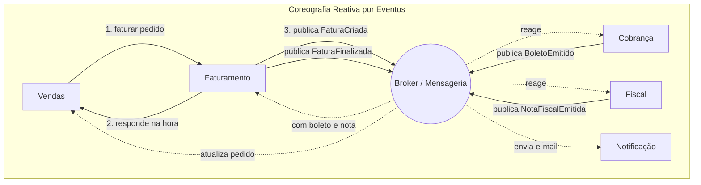
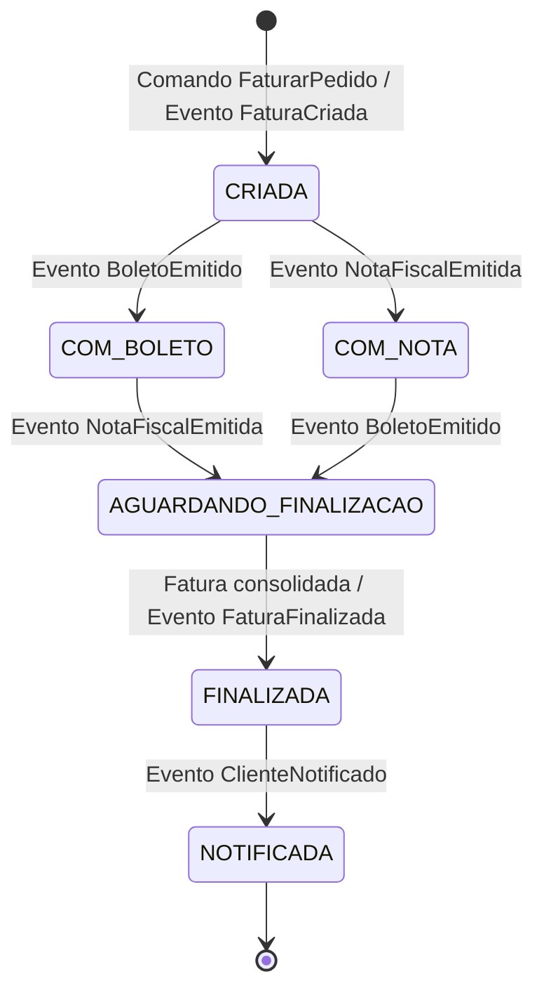
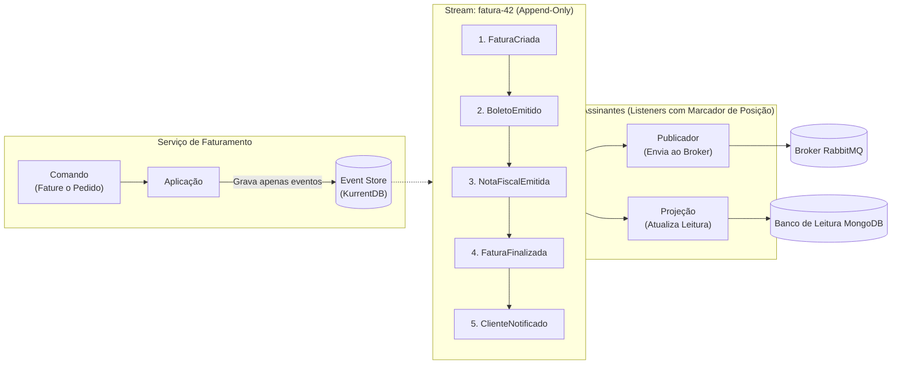
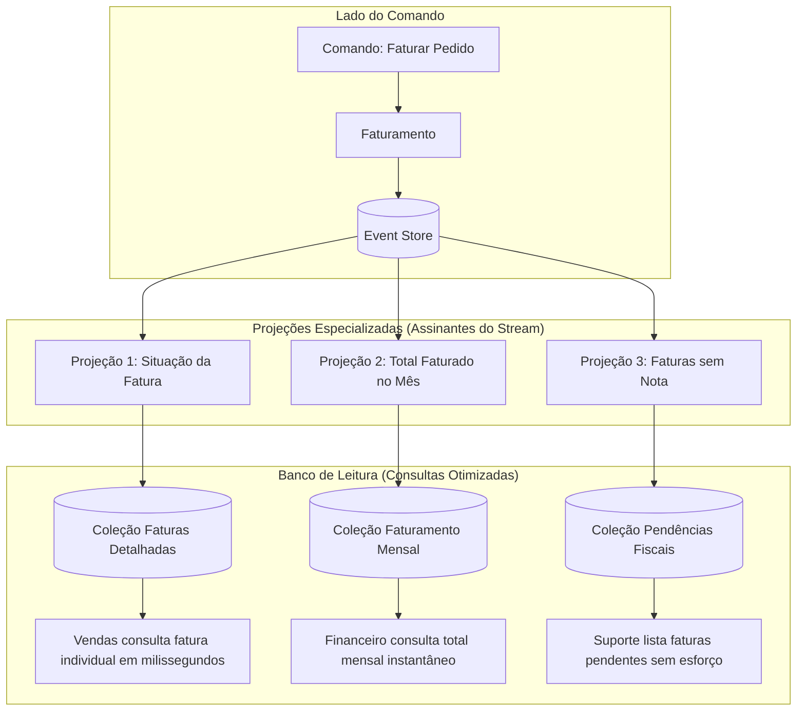
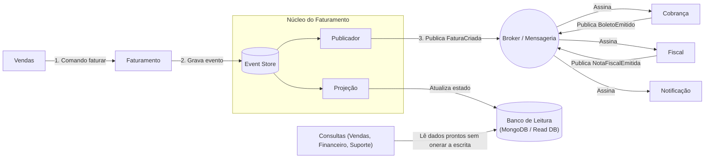

# Aula 9 — Arquitetura Orientada a Eventos: De Comandos para Eventos, Event Sourcing e CQRS

> **Disciplina:** Arquitetura de Software  
> **Professor:** Prof. Dr. Pedro Henrique Nogueira Pizzutti  
> **Tema:** Sistemas Reativos, Event Sourcing, Projeções e Segregação de Responsabilidade de Comando e Consulta (CQRS)

---

## 1. Retomando os Microsserviços: Onde Paramos

Na **Aula 8**, decompusemos o nosso sistema em microsserviços autônomos (Vendas, Faturamento, Cobrança, Fiscal e Notificação), cada qual com sua própria base de dados (*Database per Service*).

O processo de faturamento de um pedido exige cinco etapas essenciais:
1. **Criar a fatura** (Serviço de Faturamento).
2. **Emitir o boleto** (Serviço de Cobrança).
3. **Emitir a NF-e** (Serviço Fiscal).
4. **Notificar o cliente** com os documentos (Serviço de Notificação).
5. **Finalizar a fatura** (Serviço de Faturamento).

Do momento em que a fatura nasce até o seu encerramento, quatro serviços participam da dinâmica. A questão fundamental desta aula é: **como esses serviços devem conversar?**

---

## 2. Cenário 1: Arquitetura Orientada a Comandos (Orquestração / "Tudo em uma tacada só")

No modelo tradicional orientado a comandos, um processo centralizador (Faturamento) orquestra a execução enviando comandos imperativos via chamadas REST/SOAP síncronas, um após o outro:

```
[Vendas] ──(1. fature)──> [Faturamento] ──(2. emita boleto)──> [Cobrança]
                              │
                              ├──(3. emita NF-e)────> [Fiscal]
                              │
                              └──(4. notifique)─────> [Notificação]
```

### Problemas do Modelo Orientado a Comandos:
1. **Atraso Cumulativo:** A aplicação de Vendas fica bloqueada esperando a **soma de todas as chamadas**. Se a Sefaz demorar 30 segundos no Fiscal, a venda inteira trava.
2. **Falhas no Meio do Caminho:** Se o boleto for emitido com sucesso, mas a emissão da NF-e falhar, a fatura fica pela metade (inconsistente).
3. **Repetição e Efeitos Colaterais:** Retentar a chamada com falha pode gerar um segundo boleto indevido para o cliente.
4. **Acoplamento Centralizado:** O Faturamento conhece todos os participantes. Se surgir um novo passo (ex.: pontuar no programa de fidelidade), o código do Faturamento precisará ser alterado.

---

## 3. Cenário 2: Arquitetura Orientada a Eventos (Coreografia Reativa)

Em vez de ordens sequenciais centralizadas, cada serviço **reage a fatos** anunciados através de um broker de mensageria (como RabbitMQ ou Apache Kafka):



### Comparativo: Comando vs. Evento

| Característica | Comando (Uma Ordem) | Evento (Um Fato) |
|---|---|---|
| **Semântica** | No imperativo: *"Emita o boleto"*, *"Fature o pedido"* | No passado: `BoletoEmitido`, `FaturaCriada`, `NotaFiscalEmitida` |
| **Destinatário** | Direcionado a um executor específico | Anunciado em *broadcast* sem saber quem irá reagir |
| **Tempo de Espera da Venda** | A soma de todas as chamadas da cadeia | Apenas o tempo de criação inicial da fatura |
| **Se o Fiscal Cair** | A fatura inteira falha na hora | O evento aguarda na fila; o Fiscal processa assim que retornar |
| **Quem Conhece Quem** | O Faturamento precisa conhecer todos os serviços | Cada serviço conhece apenas os eventos de seu interesse |
| **Evolução do Sistema** | Um passo novo exige alterar o serviço de Faturamento | Um serviço novo simplesmente assina um evento existente |
| **Visualização do Fluxo** | Centralizado em um único código de orquestração | Distribuído nas reações individuais de cada serviço |

---

## 4. O Padrão Publicador/Assinante e os Eventos de Domínio

Os eventos circulam por tópicos no broker de mensageria, implementando o estilo arquitetural **Publicador/Assinante (Pub/Sub)**:

| Evento de Domínio | Quem Publica | Quem Assina | Ação Desencadeada |
|---|---|---|---|
| `FaturaCriada` | **Faturamento** | **Cobrança** e **Fiscal** | Cobrança gera o boleto e Fiscal emite a NF-e em paralelo |
| `BoletoEmitido` | **Cobrança** | **Faturamento** | Faturamento anexa o código de barras à fatura |
| `NotaFiscalEmitida` | **Fiscal** | **Faturamento** | Faturamento anexa o RPS e chave da nota à fatura |
| `FaturaFinalizada` | **Faturamento** | **Notificação** e **Vendas** | Notificação envia e-mail ao cliente; Vendas conclui o pedido |
| `ClienteNotificado` | **Notificação** | **Faturamento** | Faturamento registra a confirmação de entrega do e-mail |

> **Quem coordena? Os próprios domínios!**  
> Não existe um "maestro" central. Cada domínio decide de forma autônoma a que fatos reage e quais novos fatos produz.

### Ciclo de Vida da Fatura Conduzido por Eventos



*Nota:* Boleto e nota fiscal podem ser processados em qualquer ordem; o domínio da `Fatura` sabe quando ambos foram anexados para transicionar para `FINALIZADA`.

---

## 5. Event Sourcing: Guardar a História em Vez do Fim

### A Limitação do Banco Relacional Tradicional
Em um banco relacional tradicional (CRUD), uma linha na tabela `fatura` armazena apenas o **estado final**:
```sql
-- Só sabemos o estado presente; o passado foi sobrescrito!
SELECT * FROM fatura WHERE id = 42;
-- status: FINALIZADA | codigo_barras: '34191...' | rps: 'RPS-1234'
```
*Perguntas que o banco relacional não responde:*
* Quando o boleto foi emitido?
* A NF-e foi autorizada antes ou depois do boleto?
* Quanto tempo cada etapa levou?

### O Conceito de Event Sourcing
Em vez de salvar o estado final consolidado, o sistema salva **todos os eventos ocorridos em sequência temporal estrita**. Eles se tornam a **Fonte Única da Verdade** (*Single Source of Truth*).

> **A Metáfora Bancária:**
> * O saldo da sua conta bancária (R$ 400) é apenas o resultado calculado.
> * A fonte da verdade é o **extrato bancário**: `[+R$ 500, -R$ 200, +R$ 100]`.
> * No Event Sourcing, o banco armazena o "extrato" da entidade.

### Event Store e Streams (Fluxos)
Os eventos são gravados em um **Event Store** (ex.: KurrentDB, antigo EventStoreDB), um banco de dados não relacional *append-only* (onde dados nunca são atualizados ou apagados):
* Cada entidade possui seu próprio **Stream (Fluxo)**: `fatura-42`.
* Reconstituir o estado atual significa ler o stream do início ao fim e aplicar cada evento sequencialmente.



### O Marcador de Posição (Checkpoint)
Os assinantes do Event Store guardam a posição até onde leram (como um marcador de página). Se um assinante cair ou reiniciar, ele retoma exatamente de onde parou, garantindo entrega confiável sem perdas nem duplicidades.

---

## 6. CQRS (Command Query Responsibility Segregation)

### O Desafio de Consultar Eventos
O Event Store é perfeito para registrar a linha do tempo, mas ineficiente para responder a perguntas analíticas e consultas complexas:
* *"Como está a fatura 42?"* $\rightarrow$ Lê 5 eventos do stream `fatura-42` (baixo custo).
* *"Quanto foi faturado em outubro?"* $\rightarrow$ Precisaria abrir milhares de streams de faturas e somar valores (custo proibitivo!).
* *"Quais faturas estão sem nota fiscal?"* $\rightarrow$ Precisaria varrer todos os eventos de todas as faturas do banco.

### A Separação Arquitetural do CQRS
O CQRS resolve essa assimetria separando fisicamente ou logicamente o modelo de escrita do modelo de leitura:

```
                  ┌────────────────────────────────────────────────────────┐
                  │                 ARQUITETURA CQRS                       │
                  ├────────────────────────────┬───────────────────────────┤
                  │ LADO DO COMANDO (Escrita)  │ LADO DA CONSULTA (Leitura)│
┌─────────────────┼────────────────────────────┼───────────────────────────┤
│ Objetivo        │ Modificar estado e validar │ Responder consultas com   │
│                 │ regras de negócio          │ máxima velocidade         │
├─────────────────┼────────────────────────────┼───────────────────────────┤
│ Modelo de Dados │ Entidade Fatura rica       │ Documentos desnormalizados│
│                 │ protegendo invariantes     │ prontos para exibição     │
├─────────────────┼────────────────────────────┼───────────────────────────┤
│ Armazenamento   │ Event Store (Append-Only)  │ Banco de Leitura (MongoDB)│
└─────────────────┴────────────────────────────┴───────────────────────────┘
```

### Projeções Especializadas por Perfil de Consulta



---

## 7. A Arquitetura Completa: Síntese Geral

Integrando todos os blocos fundamentais: comandos entram no serviço de Faturamento, eventos de domínio são gravados no Event Store e distribuídos pelo Broker para os microsserviços reativos, enquanto Projeções alimentam bancos de leitura otimizados:



---

## 8. Quando Vale a Pena vs. Quando é Exagero

| Cenário | Vale a Pena Adotar | É Exagero (*Overengineering*) |
|---|---|---|
| **Complexidade** | Múltiplos serviços colaborando no mesmo fluxo e regras de domínio ricas | CRUD simples de cadastro e listagem básica |
| **Histórico** | A trilha de auditoria e a reconstituição temporal são vitais para o negócio | Apenas o estado presente dos dados tem relevância |
| **Carga de Leitura/Escrita** | Alto volume assimétrico de leituras complexas comparado à escrita | Poucas consultas diretas por chave primária |
| **Custos Operacionais** | Justifica manter Event Store, Brokers de mensageria e bancos de leitura | Custo e complexidade operacional superam os benefícios |

> *"A pergunta arquitetural correta não é se a técnica é moderna, mas se o problema de negócio realmente existe."*

---

## 9. Arquivos Mermaid (.mmd) nesta Pasta

- [`orientada-a-comandos-vs-eventos.mmd`](orientada-a-comandos-vs-eventos.mmd) — Comparativo entre o Cenário 1 (Comandos em cascata) e Cenário 2 (Eventos com broker).
- [`ciclo-de-vida-eventos-fatura.mmd`](ciclo-de-vida-eventos-fatura.mmd) — Máquina de estados da Fatura com transições disparadas por eventos de domínio.
- [`event-sourcing-fluxo-stream.mmd`](event-sourcing-fluxo-stream.mmd) — Estrutura de streams do Event Store e distribuição para Publicador e Projeção.
- [`cqrs-faturamento.mmd`](cqrs-faturamento.mmd) — Separação entre lado de comando, projeções especializadas e banco de leitura.
- [`arquitetura-completa-sintese.mmd`](arquitetura-completa-sintese.mmd) — Visão de ponta a ponta integrando comandos, eventos, microsserviços e consultas.
